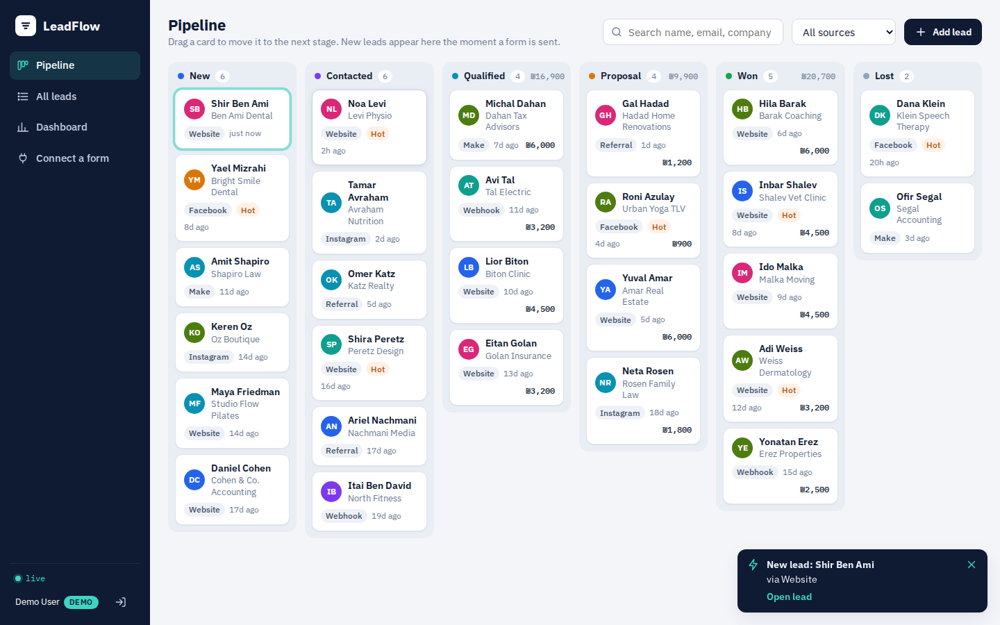
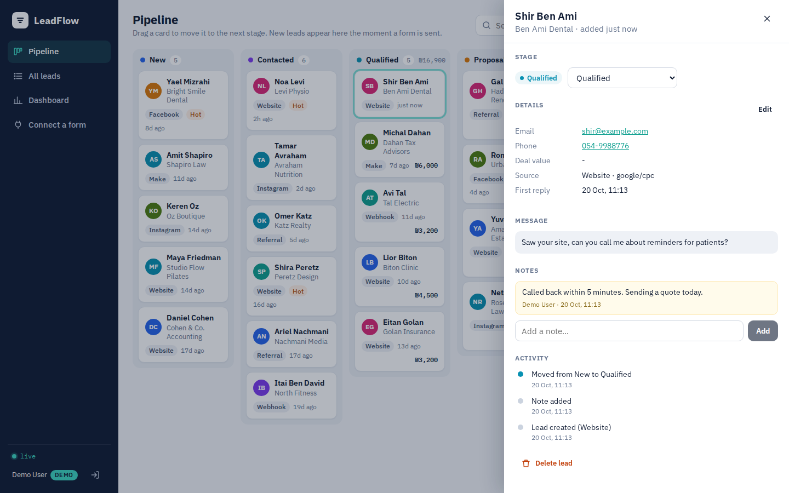
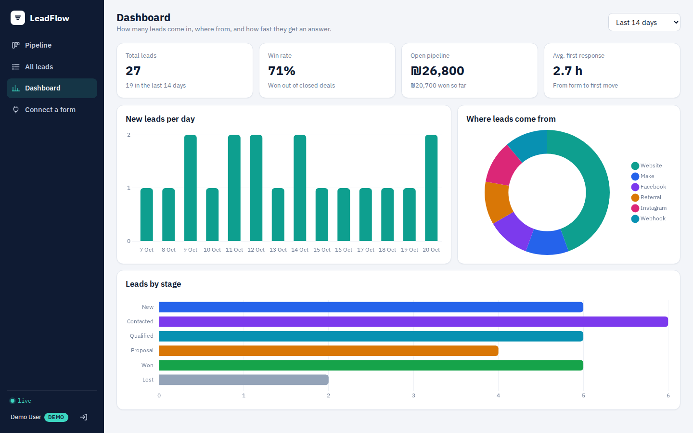
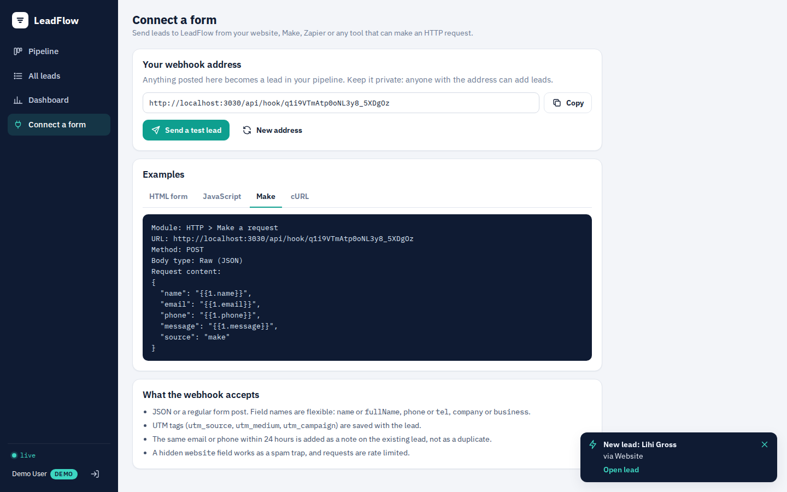
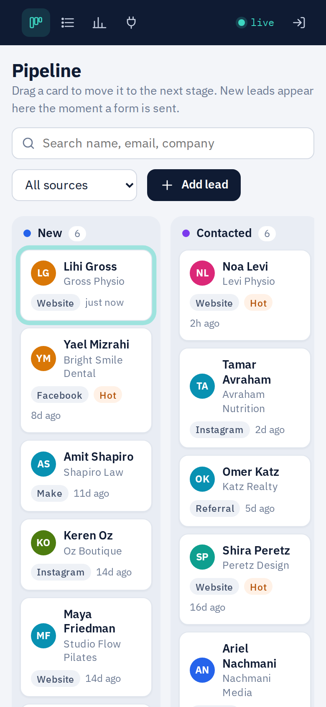
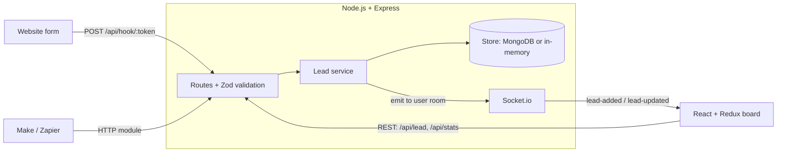

# LeadFlow

**A lead pipeline for small businesses.** Leads arrive from any website form, Make scenario or Zapier zap through one webhook, land on a drag-and-drop board in real time, and get notes, history and numbers.

Built with **React, Redux Toolkit, Node.js, Express, MongoDB and Socket.io**.

[](https://github.com/yahavmor/leadflow/actions/workflows/ci.yml)
[](https://github.com/yahavmor/leadflow/actions/workflows/e2e.yml)



## Why I built it

I build business automations in Make, and the same problem comes up with almost every client: inquiries arrive from a website form, a Facebook ad or WhatsApp, and some of them are never answered. LeadFlow is the system I would want behind those forms: one address that any form can post to, a board that updates the second a lead comes in, and a dashboard that shows how fast the business actually answers.

## Features

- **One webhook for every source.** `POST /api/hook/:token` accepts JSON or a classic form post, maps different field names (`fullName`, `tel`, `business`...), keeps UTM tags, and can redirect plain HTML forms to a thank-you page.
- **Live board.** New leads, moves and notes are pushed to every open browser of the same user over Socket.io, with a toast that opens the lead.
- **Drag and drop pipeline** with optimistic updates: the card moves instantly and moves back if the server rejects the change. Keyboard dragging works too.
- **Lead history.** Notes, an activity timeline, deal value and the time it took to answer the lead for the first time.
- **Dashboard.** Leads per day, sources, leads by stage, win rate, open pipeline value and average first response time (a MongoDB aggregation with `$facet`).
- **Duplicate protection.** The same email or phone within 24 hours becomes a note on the existing lead instead of a new card.
- **Spam and abuse protection.** Honeypot field, rate limits on the webhook and on login, input validation with Zod, Helmet headers, httpOnly JWT cookies.
- **Try-it demo.** In demo mode, "Try the live demo" logs into a sample account with a realistic pipeline that resets on every demo login.

| Lead details | Dashboard |
| --- | --- |
|  |  |

| Connect a form | Mobile |
| --- | --- |
|  |  |

## Architecture



- **Layers:** routes (HTTP, validation) → services (business rules: activity log, first response time, duplicates) → store (persistence).
- **Pluggable storage:** the store is an interface with two implementations, `mongo.store.js` (native MongoDB driver, indexes, aggregation pipeline) and `memory.store.js`. The same test suite runs against both, so the app also runs locally with zero setup.
- **One deployable:** in production Express serves the React build, the API and the WebSocket from the same origin, so cookies stay `SameSite=Lax` and there is no CORS to manage.

## API

| Method | Path | Description |
| --- | --- | --- |
| POST | `/api/auth/signup` · `/login` · `/logout` | Session with an httpOnly JWT cookie |
| POST | `/api/auth/demo` | Log into the demo account (demo mode only) |
| GET | `/api/auth/me` | Current user, including the webhook token |
| POST | `/api/auth/hook-token` | Create a new webhook address |
| GET | `/api/lead?status=&source=&q=&sort=-createdAt&page=&limit=` | List, filter, search and sort |
| POST | `/api/lead` | Create a lead manually |
| GET / PUT / DELETE | `/api/lead/:id` | Read, update or delete a lead |
| PATCH | `/api/lead/:id/status` | Move to another stage |
| POST | `/api/lead/:id/note` | Add a note |
| GET | `/api/stats?days=14` | Dashboard numbers |
| POST | `/api/hook/:token` | **Public intake** for forms and automations |

Example:

```bash
curl -X POST https://<your-app>/api/hook/<token> \
  -H 'Content-Type: application/json' \
  -d '{"name":"Noa Levi","email":"noa@example.com","phone":"050-0000000","source":"website","utm_source":"google"}'
```

## Run it locally

No database needed: without `MONGO_URL` the server uses the in-memory store.

```bash
# API on :3030
cd backend
npm install
cp .env.example .env     # DEMO_MODE=true is already set
npm run dev

# React app on :5173 (proxies /api and the socket to :3030)
cd frontend
npm install
npm run dev
```

Open http://localhost:5173 and click **Try the live demo**. To use MongoDB, set `MONGO_URL` in `backend/.env` (for example a free MongoDB Atlas cluster) and run `npm run seed` for sample data.

## Tests

```bash
cd backend && npm test      # 22 API tests: auth, leads, webhook intake, stats (Node test runner + Supertest)
cd frontend && npm test     # reducers, formatting and components (Vitest + Testing Library)

# end-to-end run in Chromium (Playwright), with the two dev servers from above running
cd e2e && npm install && npx playwright install chromium
BASE_URL=http://localhost:5173 npm test
```

CI runs the backend suite twice, against the in-memory store and against a real MongoDB 7 service container, then tests and builds the frontend. A second workflow builds the app, starts it in demo mode and drives it with Playwright: demo login, drag and drop, a lead posted to the webhook that shows up live, a note, a stage change, the dashboard and the phone layout. The screenshots in this README come from that run.

## Deploy

The repo includes a Render blueprint (`render.yaml`): one free web service that builds the frontend and starts the API.

1. Create a free MongoDB Atlas cluster and copy its connection string.
2. On Render: **New > Blueprint**, pick this repo.
3. Set `MONGO_URL` to the Atlas connection string and `PUBLIC_URL` to the service URL (`https://...onrender.com`). `JWT_SECRET` is generated for you.

## What I would add next

- Teams: several users on one workspace, with lead owners and assignment rules.
- Automatic first reply (email or WhatsApp) right from the webhook.
- Reminders for leads that sat in a stage too long, and a daily summary email.

---

Built by **Yahav Mor** · [Portfolio](https://yahavmor.github.io) · [LinkedIn](https://www.linkedin.com/in/yahav-mor-566291270/) · [GitHub](https://github.com/yahavmor)
